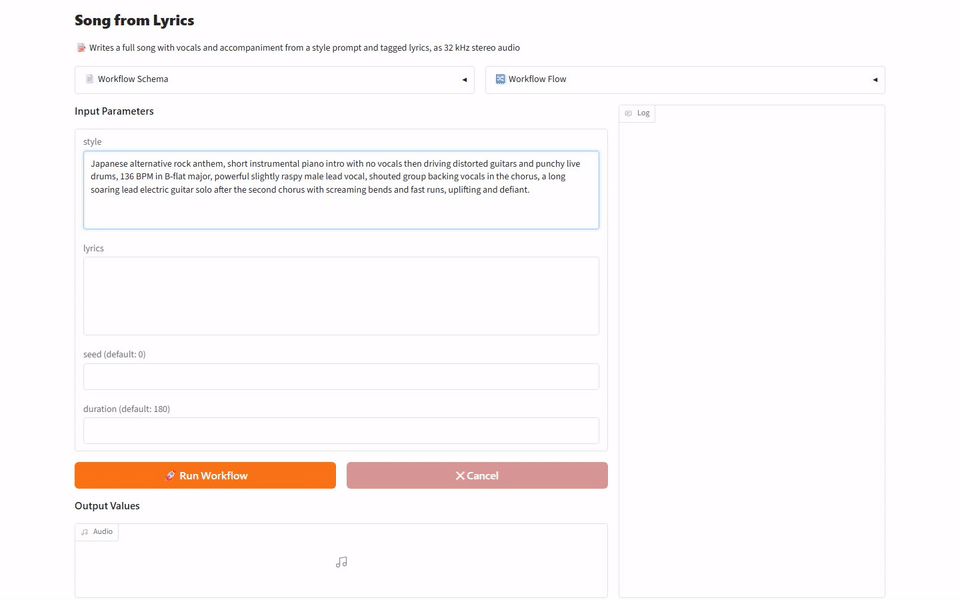
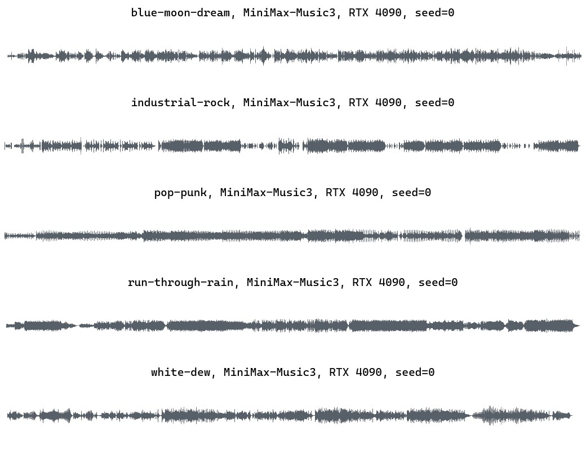

[English](README.md) · [한국어](README.ko.md) · [中文](README.zh.md)

# music-generation-minimax-music3

스타일 문장과 구간 표시가 붙은 가사를 받아 보컬과 반주가 든 노래 한 곡을 WAV로 만듭니다.



## 빠른 시작

[model-compose](https://github.com/hanyeol/model-compose) 0.4.125 이상이 필요합니다.

[uv](https://docs.astral.sh/uv/)로 설치:

```bash
uv pip install model-compose
```

또는 pip로 설치:

```bash
pip install model-compose
```

이 저장소 클론:

```bash
git clone https://github.com/MindrLabs/music-generation-minimax-music3
cd music-generation-minimax-music3
```

실행:

```bash
model-compose up
```

API 주소는 http://localhost:8080/api, Gradio UI 주소는 http://localhost:8081 입니다.

## 요약

RTX 4090은 노래 한 곡을 중앙값 257초 걸려 만들었고, 노래 길이보다 만드는 시간이 더 걸렸습니다.

| 기기 | 상태 | RTF | 최대 메모리 (MiB) |
| :---: | --- | --- | --- |
| DGX Spark | 측정 | 4.81 | 27613 (VRAM) |
| RTX 4090 | 측정 | 1.61 | 21984 (VRAM) |
| MacBook M1 16GB | 미측정 | — | — |

## 측정 환경

model-compose 0.4.124 버전으로 측정했습니다. 통계는 95% 구간을 쓰고 1.05배 미만 속도 차이는 판정하지 않습니다.

| 입력 | 가중치 |
| :---: | --- |
| 입력 5개 × 반복 3회 | [MiniMaxAI/MiniMax-Music3](https://huggingface.co/MiniMaxAI/MiniMax-Music3/tree/1b525ccb685ae809f33027c51c351eeb5833cf72) |

## 결과

- DGX Spark는 한 곡에 중앙값 751초 걸렸고 최대 메모리는 27613 MiB였습니다.
- 입력 곡 수가 적어 두 기기 사이 속도와 품질 차이는 통계로 확인하지 못했습니다.

### 가사로 노래 만들기

장르·악기·보컬을 적은 스타일 문장과 [Verse]·[Chorus] 같은 구간 표시가 붙은 가사를 넣으면 그 가사를 부르는 데모 곡이 나옵니다.

| 주장 | 확인 방법 | 통과 |
| :---: | --- | --- |
| 곡이 처음부터 끝까지 주제, 리듬, 보컬 음색을 지키며 한 곡으로 이어집니다. | 사람 판정 | ✓ |
| 곡이 음악 설명에 적은 스타일, 보컬, 악기 구성을 따릅니다. | 사람 판정 | ✓ |
| 준 가사를 구간 표시를 따라 부릅니다. | 사람 판정 | ✓ |

DGX Spark, RTX 4090 기기에서 측정했습니다. MacBook M1 16GB 기기에서는 측정하지 못했습니다. RTF는 처리에 걸린 시간을 오디오나 영상 길이로 나눈 값이라 낮을수록 빠릅니다. 각 칸은 측정한 호출의 중앙값이며 다른 GPU 작업 중에 한 호출은 빼고 계산합니다.

| 기기 | RTF | 호출당 초 | 최대 메모리 (MiB) | aes_ce | aes_cu | aes_pc | aes_pq | inner_silence_ratio | leading_silence_sec | longest_gap_sec | silence_ratio | songeval_clarity | songeval_coherence | songeval_memorability | songeval_musicality | songeval_naturalness | speech_sec | trailing_silence_sec |
| :---: | --- | --- | --- | --- | --- | --- | --- | --- | --- | --- | --- | --- | --- | --- | --- | --- | --- | --- |
| DGX Spark | 4.81 | 751 | 27613 (VRAM) | 7.31 | 7.81 | 6.54 | 8.12 | 0.613 | 3.62 | 5.81 | 0.625 | 4.09 | 4.25 | 4.21 | 4.04 | 4.01 | 54.9 | 2.08 |
| RTX 4090 | 1.61 | 257 | 21984 (VRAM) | 7.38 | 7.78 | 6.53 | 8.09 | 0.566 | 3.01 | 4.81 | 0.577 | 3.97 | 4.14 | 4.1 | 3.95 | 3.87 | 64.9 | 2.06 |

| 지표 | 뜻 | 좋은 쪽 |
| :---: | --- | --- |
| aes_ce | Audiobox Aesthetics 콘텐츠 즐거움, 대략 1~10 | 높을수록 |
| aes_cu | Audiobox Aesthetics 콘텐츠 쓸모, 대략 1~10 | 높을수록 |
| aes_pc | Audiobox Aesthetics 제작 복잡도, 대략 1~10 | 중립 |
| aes_pq | Audiobox Aesthetics 제작 품질, 대략 1~10 | 높을수록 |
| inner_silence_ratio | 첫 소리와 마지막 소리 사이 무음 비율 | 중립 |
| leading_silence_sec | 첫 소리 앞 무음 시간(초) | 중립 |
| longest_gap_sec | 첫 소리와 마지막 소리 사이 가장 긴 무음 시간(초) | 낮을수록 |
| silence_ratio | 전체 오디오 중 무음 비율 | 중립 |
| songeval_clarity | SongEval 곡 구조의 명확성, 1~5 | 높을수록 |
| songeval_coherence | SongEval 전체 일관성, 1~5 | 높을수록 |
| songeval_memorability | SongEval 기억에 남는 정도, 1~5 | 높을수록 |
| songeval_musicality | SongEval 전체 음악성, 1~5 | 높을수록 |
| songeval_naturalness | SongEval 보컬 호흡과 프레이징이 자연스러운 정도, 1~5 | 높을수록 |
| speech_sec | 무음 기준보다 큰 소리가 난 시간(초) | 중립 |
| trailing_silence_sec | 마지막 소리 뒤 무음 시간(초) | 중립 |

[](https://mindrlabs.github.io/music-generation-minimax-music3/samples/#generate-v1.nvidia-rtx-4090-24gb)

- blue-moon-dream, MiniMax-Music3, RTX 4090, seed=0: [lyrics](docs/inputs/generate-v1/blue-moon-dream/lyrics.txt) · [출력](docs/samples/generate-v1.nvidia-rtx-4090-24gb.c00.blue-moon-dream.r1.wav)
  > K-pop girl group trip hop in C major at 76 BPM half-time, driven by a deep, warm sub bass and a heavy, punchy breakbeat with crisp snare and booming kick up front in the mix, soft piano chords and hazy pads underneath, airy layered female vocals with close harmonies, wide stereo panning, a key change lifting into the second verse, an instrumental intro with no vocals, dreamy and hypnotic.
- industrial-rock, MiniMax-Music3, RTX 4090, seed=0: [lyrics](docs/inputs/generate-v1/industrial-rock/lyrics.txt) · [출력](docs/samples/generate-v1.nvidia-rtx-4090-24gb.c00.industrial-rock.r1.wav)
  > Dark industrial pop rock with grunge grit, a heavy distorted bass riff, stomping drums with hard claps, gritty fuzz guitars, a shouted chorus, male lead vocal with gang vocals, 139 BPM in D-sharp minor, an instrumental bass intro with no vocals, menacing and intense.
- pop-punk, MiniMax-Music3, RTX 4090, seed=0: [lyrics](docs/inputs/generate-v1/pop-punk/lyrics.txt) · [출력](docs/samples/generate-v1.nvidia-rtx-4090-24gb.c00.pop-punk.r1.wav)
  > Early-2000s pop-punk, crunchy power-chord electric guitars, palm-muted verses bursting into a big open chorus, driving punk drums and bass, 150 BPM in D major, bratty and confident female lead vocal, an instrumental guitar intro with no vocals, rebellious teenage energy.
- run-through-rain, MiniMax-Music3, RTX 4090, seed=0: [lyrics](docs/inputs/generate-v1/run-through-rain/lyrics.txt) · [출력](docs/samples/generate-v1.nvidia-rtx-4090-24gb.c00.run-through-rain.r1.wav)
  > Japanese alternative rock anthem, short instrumental piano intro with no vocals then driving distorted guitars and punchy live drums, 136 BPM in B-flat major, powerful slightly raspy male lead vocal, shouted group backing vocals in the chorus, a long soaring lead electric guitar solo after the second chorus with screaming bends and fast runs, uplifting and defiant.
- white-dew, MiniMax-Music3, RTX 4090, seed=0: [lyrics](docs/inputs/generate-v1/white-dew/lyrics.txt) · [출력](docs/samples/generate-v1.nvidia-rtx-4090-24gb.c00.white-dew.r1.wav)
  > Mandarin pop ballad, soft electric piano and warm synth pads over a light electronic pop beat, 98 BPM in G major, clear and sweet female lead vocal, gentle rounded bass, an instrumental intro with no vocals, nostalgic autumn mood.

## 추천

- RTX 4090에서 최대 메모리가 21984 MiB까지 올랐으니 같은 카드에서 다른 GPU 작업을 함께 돌리지 않는 편이 낫습니다.

## 한계와 측정하지 않은 것

### 측정 조건

| 항목 | 내용 |
| :---: | --- |
| 제약 | 단계 사이에 쉬는 하위 모델을 CPU 메모리에 두는 cpu_offload: model로 쟀고, 오프로드 없이 돌린 경우는 재지 않았습니다. |

### 측정하지 못한 것

| 대상 | 항목 | 이유 |
| :---: | --- | --- |
| MacBook M1 16GB | 모든 측정 | MacBook M1에 네트워크로 접속할 수 없었고, 모델 카드가 추론에 CUDA가 필요하다고 하는데 Apple M1에는 CUDA가 없습니다. |
| DGX Spark / RTX 4090 | RTF | 두 기기 모두 다른 GPU 작업 없이 잰 입력이 5개뿐이라 최소 20개가 필요합니다. |
| DGX Spark / RTX 4090 | aes_ce | 두 기기 모두 채점한 입력이 5개뿐이라 최소 20개가 필요합니다. |
| DGX Spark / RTX 4090 | aes_cu | 두 기기 모두 채점한 입력이 5개뿐이라 최소 20개가 필요합니다. |
| DGX Spark / RTX 4090 | aes_pq | 두 기기 모두 채점한 입력이 5개뿐이라 최소 20개가 필요합니다. |
| DGX Spark / RTX 4090 | longest_gap_sec | 두 기기 모두 채점한 입력이 5개뿐이라 최소 20개가 필요합니다. |
| DGX Spark / RTX 4090 | songeval_clarity | 두 기기 모두 채점한 입력이 5개뿐이라 최소 20개가 필요합니다. |
| DGX Spark / RTX 4090 | songeval_coherence | 두 기기 모두 채점한 입력이 5개뿐이라 최소 20개가 필요합니다. |
| DGX Spark / RTX 4090 | songeval_memorability | 두 기기 모두 채점한 입력이 5개뿐이라 최소 20개가 필요합니다. |
| DGX Spark / RTX 4090 | songeval_musicality | 두 기기 모두 채점한 입력이 5개뿐이라 최소 20개가 필요합니다. |
| DGX Spark / RTX 4090 | songeval_naturalness | 두 기기 모두 채점한 입력이 5개뿐이라 최소 20개가 필요합니다. |

### 확인하지 않은 모델 카드 주장

- 오디오는 최대 9,000 음향 프레임까지 만듭니다.
- 빠르기, 조성, 악기, 가사, 구조가 요청한 세부와 모두 맞지는 않을 수 있습니다.
- 전체 정밀도로 VRAM 24GB 안에 들어가고, 오프로드하면 8GB 카드까지 내려갑니다.
- 한 곡을 최대 오 분 길이로 만듭니다.
- 추론에 CUDA가 필요합니다.
- 텍스트 프롬프트는 토큰으로 바꿔 최대 5,000토큰까지 받습니다.
- 32 kHz, 16비트 스테레오 오디오를 만듭니다.

## 라이선스

| 대상 | 라이선스 | 상업적 이용 |
| :---: | --- | --- |
| 이 서비스 | [`LICENSE`](LICENSE) | ✓ |
| MiniMaxAI/MiniMax-Music3 가중치 | [`MODEL_LICENSE`](https://huggingface.co/MiniMaxAI/MiniMax-Music3/blob/main/LICENSE) | ✓ |
