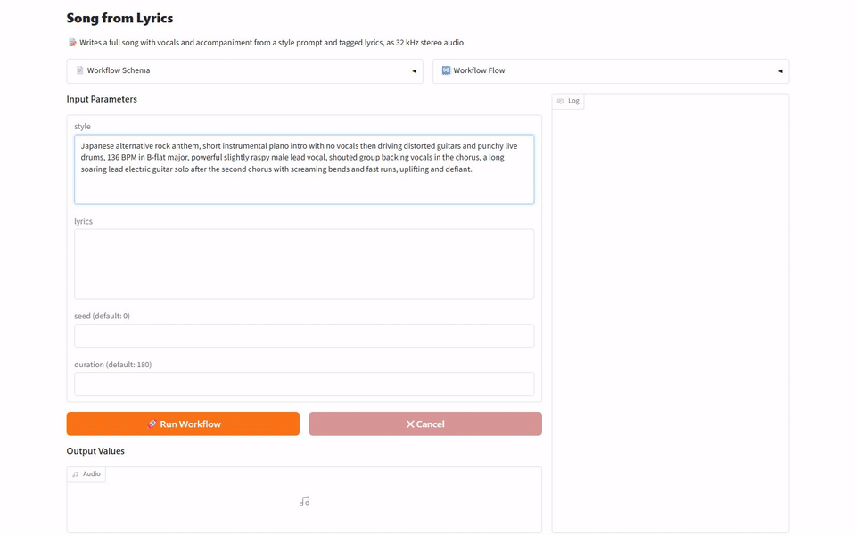
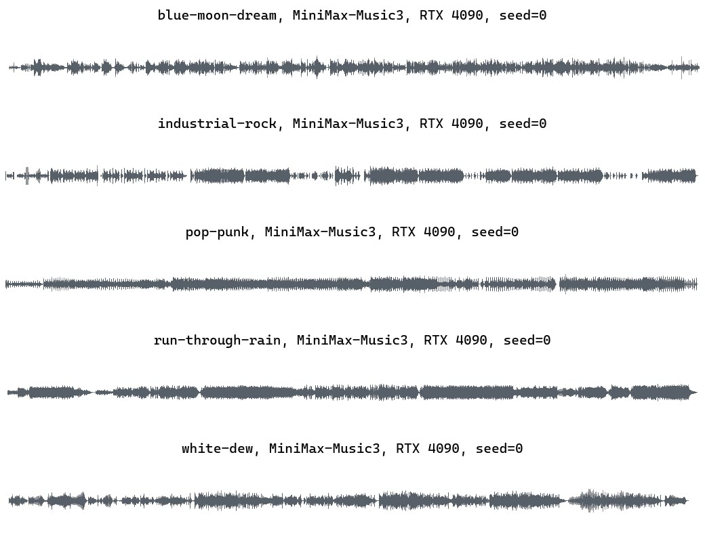

[English](README.md) · [한국어](README.ko.md) · [中文](README.zh.md)

# music-generation-minimax-music3

This service takes a style prompt and section-tagged lyrics and returns one full song with vocals and accompaniment as a WAV file.



## Quick Start

It needs [model-compose](https://github.com/hanyeol/model-compose) 0.4.125 or later.

Install with [uv](https://docs.astral.sh/uv/):

```bash
uv pip install model-compose
```

Or with pip:

```bash
pip install model-compose
```

Clone this repository:

```bash
git clone https://github.com/MindrLabs/music-generation-minimax-music3
cd music-generation-minimax-music3
```

Run it:

```bash
model-compose up
```

The API listens on http://localhost:8080/api and the Gradio UI opens at http://localhost:8081.

## Summary

The RTX 4090 made one song in a median of 257 seconds, taking longer to make each song than the song lasts.

| Machine | Status | RTF | Peak memory (MiB) |
| :---: | --- | --- | --- |
| DGX Spark | Measured | 4.81 | 27613 (VRAM) |
| RTX 4090 | Measured | 1.61 | 21984 (VRAM) |
| MacBook M1 16GB | Not measured | — | — |

## Setup

Measured with model-compose 0.4.124. Statistics use 95% intervals, and speed differences under 1.05× are not called.

| Inputs | Weights |
| :---: | --- |
| 5 inputs × 3 repeats | [MiniMaxAI/MiniMax-Music3](https://huggingface.co/MiniMaxAI/MiniMax-Music3/tree/1b525ccb685ae809f33027c51c351eeb5833cf72) |

## Results

- The DGX Spark took a median of 751 seconds per song and peaked at 27613 MiB of memory.
- With so few input songs, the speed and quality differences between the two machines could not be confirmed statistically.

### Song from Lyrics

Put in a style prompt naming the genre, instruments and vocals, plus lyrics tagged with sections like [Verse] and [Chorus], and a demo song that sings those lyrics comes out.

| Claim | Check | Pass |
| :---: | --- | --- |
| The song keeps its themes, rhythm and vocal identity from start to end as one complete song. | Judged by a person | ✓ |
| The song follows the style, vocals and instrumentation named in the music description. | Judged by a person | ✓ |
| The given lyrics are sung, following their section tags. | Judged by a person | ✓ |

We measured on DGX Spark, RTX 4090. We could not measure on MacBook M1 16GB. RTF is the processing time divided by the length of the audio or video, so lower is faster. Each cell is the median over measured calls, leaving out any call made during other GPU work.

| Machine | RTF | Seconds per call | Peak memory (MiB) | aes_ce | aes_cu | aes_pc | aes_pq | inner_silence_ratio | leading_silence_sec | longest_gap_sec | silence_ratio | songeval_clarity | songeval_coherence | songeval_memorability | songeval_musicality | songeval_naturalness | speech_sec | trailing_silence_sec |
| :---: | --- | --- | --- | --- | --- | --- | --- | --- | --- | --- | --- | --- | --- | --- | --- | --- | --- | --- |
| DGX Spark | 4.81 | 751 | 27613 (VRAM) | 7.31 | 7.81 | 6.54 | 8.12 | 0.613 | 3.62 | 5.81 | 0.625 | 4.09 | 4.25 | 4.21 | 4.04 | 4.01 | 54.9 | 2.08 |
| RTX 4090 | 1.61 | 257 | 21984 (VRAM) | 7.38 | 7.78 | 6.53 | 8.09 | 0.566 | 3.01 | 4.81 | 0.577 | 3.97 | 4.14 | 4.1 | 3.95 | 3.87 | 64.9 | 2.06 |

| Metric | Meaning | Better |
| :---: | --- | --- |
| aes_ce | Audiobox Aesthetics content enjoyment, about 1 to 10 | Higher |
| aes_cu | Audiobox Aesthetics content usefulness, about 1 to 10 | Higher |
| aes_pc | Audiobox Aesthetics production complexity, about 1 to 10 | Neither |
| aes_pq | Audiobox Aesthetics production quality, about 1 to 10 | Higher |
| inner_silence_ratio | Share of the audio between the first and last sound that is silent | Neither |
| leading_silence_sec | Seconds of silence before the first sound | Neither |
| longest_gap_sec | Longest silent stretch between the first and last sound, in seconds | Lower |
| silence_ratio | Share of the whole audio that is silent | Neither |
| songeval_clarity | SongEval clarity of song structure, 1 to 5 | Higher |
| songeval_coherence | SongEval overall coherence, 1 to 5 | Higher |
| songeval_memorability | SongEval memorability, 1 to 5 | Higher |
| songeval_musicality | SongEval overall musicality, 1 to 5 | Higher |
| songeval_naturalness | SongEval naturalness of vocal breathing and phrasing, 1 to 5 | Higher |
| speech_sec | Seconds of audio above the silence threshold | Neither |
| trailing_silence_sec | Seconds of silence after the last sound | Neither |

[](https://mindrlabs.github.io/music-generation-minimax-music3/samples/#generate-v1.nvidia-rtx-4090-24gb)

- blue-moon-dream, MiniMax-Music3, RTX 4090, seed=0: [lyrics](docs/inputs/generate-v1/blue-moon-dream/lyrics.txt) · [output](docs/samples/generate-v1.nvidia-rtx-4090-24gb.c00.blue-moon-dream.r1.wav)
  > K-pop girl group trip hop in C major at 76 BPM half-time, driven by a deep, warm sub bass and a heavy, punchy breakbeat with crisp snare and booming kick up front in the mix, soft piano chords and hazy pads underneath, airy layered female vocals with close harmonies, wide stereo panning, a key change lifting into the second verse, an instrumental intro with no vocals, dreamy and hypnotic.
- industrial-rock, MiniMax-Music3, RTX 4090, seed=0: [lyrics](docs/inputs/generate-v1/industrial-rock/lyrics.txt) · [output](docs/samples/generate-v1.nvidia-rtx-4090-24gb.c00.industrial-rock.r1.wav)
  > Dark industrial pop rock with grunge grit, a heavy distorted bass riff, stomping drums with hard claps, gritty fuzz guitars, a shouted chorus, male lead vocal with gang vocals, 139 BPM in D-sharp minor, an instrumental bass intro with no vocals, menacing and intense.
- pop-punk, MiniMax-Music3, RTX 4090, seed=0: [lyrics](docs/inputs/generate-v1/pop-punk/lyrics.txt) · [output](docs/samples/generate-v1.nvidia-rtx-4090-24gb.c00.pop-punk.r1.wav)
  > Early-2000s pop-punk, crunchy power-chord electric guitars, palm-muted verses bursting into a big open chorus, driving punk drums and bass, 150 BPM in D major, bratty and confident female lead vocal, an instrumental guitar intro with no vocals, rebellious teenage energy.
- run-through-rain, MiniMax-Music3, RTX 4090, seed=0: [lyrics](docs/inputs/generate-v1/run-through-rain/lyrics.txt) · [output](docs/samples/generate-v1.nvidia-rtx-4090-24gb.c00.run-through-rain.r1.wav)
  > Japanese alternative rock anthem, short instrumental piano intro with no vocals then driving distorted guitars and punchy live drums, 136 BPM in B-flat major, powerful slightly raspy male lead vocal, shouted group backing vocals in the chorus, a long soaring lead electric guitar solo after the second chorus with screaming bends and fast runs, uplifting and defiant.
- white-dew, MiniMax-Music3, RTX 4090, seed=0: [lyrics](docs/inputs/generate-v1/white-dew/lyrics.txt) · [output](docs/samples/generate-v1.nvidia-rtx-4090-24gb.c00.white-dew.r1.wav)
  > Mandarin pop ballad, soft electric piano and warm synth pads over a light electronic pop beat, 98 BPM in G major, clear and sweet female lead vocal, gentle rounded bass, an instrumental intro with no vocals, nostalgic autumn mood.

## Recommendations

- Memory peaked at 21984 MiB on the RTX 4090, so on that card it is better not to run other GPU work alongside it.

## Limitations and What We Did Not Measure

### Measurement Conditions

| Item | Detail |
| :---: | --- |
| Constraint | Measured with cpu_offload: model, which keeps idle submodels in CPU memory between stages; runs without offload were not measured. |

### Not Measured

| Subject | Item | Reason |
| :---: | --- | --- |
| MacBook M1 16GB | Every measurement | The MacBook M1 could not be reached over the network, and the model card says inference requires CUDA, which an Apple M1 does not have. |
| DGX Spark vs RTX 4090 | RTF | Only 5 inputs were measured on both machines without other GPU work; at least 20 are needed. |
| DGX Spark vs RTX 4090 | aes_ce | Only 5 inputs were scored on both machines; at least 20 are needed. |
| DGX Spark vs RTX 4090 | aes_cu | Only 5 inputs were scored on both machines; at least 20 are needed. |
| DGX Spark vs RTX 4090 | aes_pq | Only 5 inputs were scored on both machines; at least 20 are needed. |
| DGX Spark vs RTX 4090 | longest_gap_sec | Only 5 inputs were scored on both machines; at least 20 are needed. |
| DGX Spark vs RTX 4090 | songeval_clarity | Only 5 inputs were scored on both machines; at least 20 are needed. |
| DGX Spark vs RTX 4090 | songeval_coherence | Only 5 inputs were scored on both machines; at least 20 are needed. |
| DGX Spark vs RTX 4090 | songeval_memorability | Only 5 inputs were scored on both machines; at least 20 are needed. |
| DGX Spark vs RTX 4090 | songeval_musicality | Only 5 inputs were scored on both machines; at least 20 are needed. |
| DGX Spark vs RTX 4090 | songeval_naturalness | Only 5 inputs were scored on both machines; at least 20 are needed. |

### Unchecked Model Card Claims

- Audio generation is limited to 9,000 acoustic frames.
- The tempo, key, instrumentation, lyrics and structure may not match every requested detail.
- Full precision fits under 24GB of VRAM, and offloading brings it down to 8 GB cards.
- A full song can be up to five minutes long.
- Inference requires CUDA.
- The tokenized text prompt is limited to 5,000 tokens.
- The model produces 32 kHz, 16-bit stereo audio.

## License

| Covers | License | Commercial use |
| :---: | --- | --- |
| This service | [`LICENSE`](LICENSE) | ✓ |
| MiniMaxAI/MiniMax-Music3 weights | [`MODEL_LICENSE`](https://huggingface.co/MiniMaxAI/MiniMax-Music3/blob/main/LICENSE) | ✓ |
