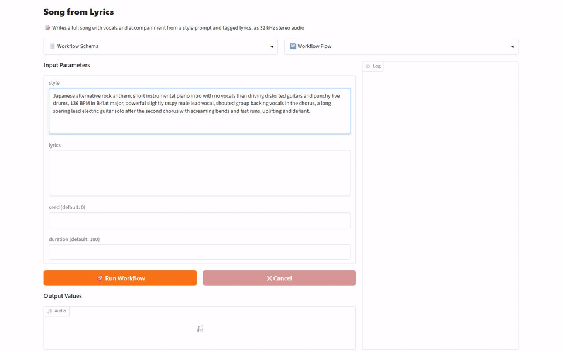
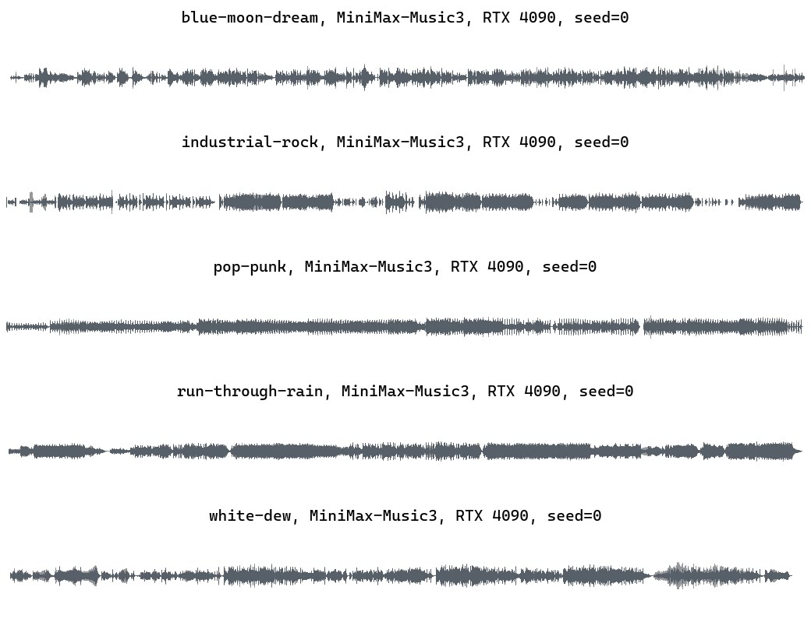

[English](README.md) · [한국어](README.ko.md) · [中文](README.zh.md)

# music-generation-minimax-music3

这个服务接收风格描述和带段落标记的歌词，生成一首带人声和伴奏的完整歌曲，输出为 WAV 文件。



## 快速开始

需要 [model-compose](https://github.com/hanyeol/model-compose) 0.4.125 或更高版本。

使用 [uv](https://docs.astral.sh/uv/) 安装：

```bash
uv pip install model-compose
```

或使用 pip 安装：

```bash
pip install model-compose
```

克隆此仓库：

```bash
git clone https://github.com/MindrLabs/music-generation-minimax-music3
cd music-generation-minimax-music3
```

运行：

```bash
model-compose up
```

API 地址为 http://localhost:8080/api ，Gradio 界面地址为 http://localhost:8081 。

## 摘要

RTX 4090 生成一首歌的中位数耗时 257 秒，生成时间比歌曲本身还长。

| 设备 | 状态 | RTF | 峰值内存 (MiB) |
| :---: | --- | --- | --- |
| DGX Spark | 已测量 | 4.81 | 27613 (VRAM) |
| RTX 4090 | 已测量 | 1.61 | 21984 (VRAM) |
| MacBook M1 16GB | 未测量 | — | — |

## 测量环境

使用 model-compose 0.4.124 测量。统计使用 95% 置信区间，低于 1.05× 的速度差异不作判定。

| 输入 | 权重 |
| :---: | --- |
| 5 个输入 × 3 次重复 | [MiniMaxAI/MiniMax-Music3](https://huggingface.co/MiniMaxAI/MiniMax-Music3/tree/1b525ccb685ae809f33027c51c351eeb5833cf72) |

## 结果

- DGX Spark 每首歌的中位数耗时 751 秒，内存峰值为 27613 MiB。
- 输入歌曲太少，两台设备之间的速度和质量差异无法在统计上确认。

### 歌词生成歌曲

输入写明曲风、乐器和人声的风格描述，以及带有 [Verse]、[Chorus] 等段落标记的歌词，就会得到一首演唱这些歌词的小样。

| 声明 | 核对方式 | 通过 |
| :---: | --- | --- |
| 歌曲从头到尾保持主题、节奏和人声音色，是一首完整的歌。 | 人工判定 | ✓ |
| 歌曲遵循音乐描述中写明的风格、人声和配器。 | 人工判定 | ✓ |
| 按段落标记演唱给定的歌词。 | 人工判定 | ✓ |

在 DGX Spark、RTX 4090 上进行了测量。未能在 MacBook M1 16GB 上进行测量。RTF 是处理耗时除以音频或视频时长，越低越快。每格为所测调用的中位数，计算时不计入在其他 GPU 任务期间进行的调用。

| 设备 | RTF | 每次调用秒数 | 峰值内存 (MiB) | aes_ce | aes_cu | aes_pc | aes_pq | inner_silence_ratio | leading_silence_sec | longest_gap_sec | silence_ratio | songeval_clarity | songeval_coherence | songeval_memorability | songeval_musicality | songeval_naturalness | speech_sec | trailing_silence_sec |
| :---: | --- | --- | --- | --- | --- | --- | --- | --- | --- | --- | --- | --- | --- | --- | --- | --- | --- | --- |
| DGX Spark | 4.81 | 751 | 27613 (VRAM) | 7.31 | 7.81 | 6.54 | 8.12 | 0.613 | 3.62 | 5.81 | 0.625 | 4.09 | 4.25 | 4.21 | 4.04 | 4.01 | 54.9 | 2.08 |
| RTX 4090 | 1.61 | 257 | 21984 (VRAM) | 7.38 | 7.78 | 6.53 | 8.09 | 0.566 | 3.01 | 4.81 | 0.577 | 3.97 | 4.14 | 4.1 | 3.95 | 3.87 | 64.9 | 2.06 |

| 指标 | 含义 | 更好的方向 |
| :---: | --- | --- |
| aes_ce | Audiobox Aesthetics 内容享受度，约 1 到 10 | 越高 |
| aes_cu | Audiobox Aesthetics 内容实用性，约 1 到 10 | 越高 |
| aes_pc | Audiobox Aesthetics 制作复杂度，约 1 到 10 | 无 |
| aes_pq | Audiobox Aesthetics 制作质量，约 1 到 10 | 越高 |
| inner_silence_ratio | 第一个与最后一个声音之间静音所占比例 | 无 |
| leading_silence_sec | 第一个声音之前的静音秒数 | 无 |
| longest_gap_sec | 第一个与最后一个声音之间最长的静音秒数 | 越低 |
| silence_ratio | 整段音频中静音所占比例 | 无 |
| songeval_clarity | SongEval 歌曲结构清晰度，1 到 5 | 越高 |
| songeval_coherence | SongEval 整体连贯性，1 到 5 | 越高 |
| songeval_memorability | SongEval 记忆度，1 到 5 | 越高 |
| songeval_musicality | SongEval 整体音乐性，1 到 5 | 越高 |
| songeval_naturalness | SongEval 人声呼吸与乐句的自然度，1 到 5 | 越高 |
| speech_sec | 高于静音阈值的音频秒数 | 无 |
| trailing_silence_sec | 最后一个声音之后的静音秒数 | 无 |

[](https://mindrlabs.github.io/music-generation-minimax-music3/samples/#generate-v1.nvidia-rtx-4090-24gb)

- blue-moon-dream, MiniMax-Music3, RTX 4090, seed=0: [lyrics](docs/inputs/generate-v1/blue-moon-dream/lyrics.txt) · [输出](docs/samples/generate-v1.nvidia-rtx-4090-24gb.c00.blue-moon-dream.r1.wav)
  > K-pop girl group trip hop in C major at 76 BPM half-time, driven by a deep, warm sub bass and a heavy, punchy breakbeat with crisp snare and booming kick up front in the mix, soft piano chords and hazy pads underneath, airy layered female vocals with close harmonies, wide stereo panning, a key change lifting into the second verse, an instrumental intro with no vocals, dreamy and hypnotic.
- industrial-rock, MiniMax-Music3, RTX 4090, seed=0: [lyrics](docs/inputs/generate-v1/industrial-rock/lyrics.txt) · [输出](docs/samples/generate-v1.nvidia-rtx-4090-24gb.c00.industrial-rock.r1.wav)
  > Dark industrial pop rock with grunge grit, a heavy distorted bass riff, stomping drums with hard claps, gritty fuzz guitars, a shouted chorus, male lead vocal with gang vocals, 139 BPM in D-sharp minor, an instrumental bass intro with no vocals, menacing and intense.
- pop-punk, MiniMax-Music3, RTX 4090, seed=0: [lyrics](docs/inputs/generate-v1/pop-punk/lyrics.txt) · [输出](docs/samples/generate-v1.nvidia-rtx-4090-24gb.c00.pop-punk.r1.wav)
  > Early-2000s pop-punk, crunchy power-chord electric guitars, palm-muted verses bursting into a big open chorus, driving punk drums and bass, 150 BPM in D major, bratty and confident female lead vocal, an instrumental guitar intro with no vocals, rebellious teenage energy.
- run-through-rain, MiniMax-Music3, RTX 4090, seed=0: [lyrics](docs/inputs/generate-v1/run-through-rain/lyrics.txt) · [输出](docs/samples/generate-v1.nvidia-rtx-4090-24gb.c00.run-through-rain.r1.wav)
  > Japanese alternative rock anthem, short instrumental piano intro with no vocals then driving distorted guitars and punchy live drums, 136 BPM in B-flat major, powerful slightly raspy male lead vocal, shouted group backing vocals in the chorus, a long soaring lead electric guitar solo after the second chorus with screaming bends and fast runs, uplifting and defiant.
- white-dew, MiniMax-Music3, RTX 4090, seed=0: [lyrics](docs/inputs/generate-v1/white-dew/lyrics.txt) · [输出](docs/samples/generate-v1.nvidia-rtx-4090-24gb.c00.white-dew.r1.wav)
  > Mandarin pop ballad, soft electric piano and warm synth pads over a light electronic pop beat, 98 BPM in G major, clear and sweet female lead vocal, gentle rounded bass, an instrumental intro with no vocals, nostalgic autumn mood.

## 建议

- RTX 4090 上内存峰值达到 21984 MiB，因此在这张显卡上最好不要同时运行其他 GPU 任务。

## 局限与未测量的内容

### 测量条件

| 项目 | 内容 |
| :---: | --- |
| 限制 | 使用 cpu_offload: model 测量，即在各阶段之间把空闲的子模型放在 CPU 内存中；未测量不使用卸载的运行。 |

### 未能测量的内容

| 对象 | 项目 | 原因 |
| :---: | --- | --- |
| MacBook M1 16GB | 全部测量 | 无法通过网络连接 MacBook M1，而且模型卡说明推理需要 CUDA，Apple M1 没有 CUDA。 |
| DGX Spark 与 RTX 4090 | RTF | 两台设备在没有其他 GPU 任务时都测过的输入只有 5 个，至少需要 20 个。 |
| DGX Spark 与 RTX 4090 | aes_ce | 两台设备都打过分的输入只有 5 个，至少需要 20 个。 |
| DGX Spark 与 RTX 4090 | aes_cu | 两台设备都打过分的输入只有 5 个，至少需要 20 个。 |
| DGX Spark 与 RTX 4090 | aes_pq | 两台设备都打过分的输入只有 5 个，至少需要 20 个。 |
| DGX Spark 与 RTX 4090 | longest_gap_sec | 两台设备都打过分的输入只有 5 个，至少需要 20 个。 |
| DGX Spark 与 RTX 4090 | songeval_clarity | 两台设备都打过分的输入只有 5 个，至少需要 20 个。 |
| DGX Spark 与 RTX 4090 | songeval_coherence | 两台设备都打过分的输入只有 5 个，至少需要 20 个。 |
| DGX Spark 与 RTX 4090 | songeval_memorability | 两台设备都打过分的输入只有 5 个，至少需要 20 个。 |
| DGX Spark 与 RTX 4090 | songeval_musicality | 两台设备都打过分的输入只有 5 个，至少需要 20 个。 |
| DGX Spark 与 RTX 4090 | songeval_naturalness | 两台设备都打过分的输入只有 5 个，至少需要 20 个。 |

### 未核实的模型卡声明

- 音频生成最多 9,000 个声学帧。
- 速度、调性、配器、歌词和结构可能无法完全符合每个要求的细节。
- 全精度可放进 24GB 显存，开启卸载后可降到 8GB 显卡。
- 一首完整歌曲最长可达五分钟。
- 推理需要 CUDA。
- 文本提示词分词后最多 5,000 个 token。
- 模型生成 32 kHz、16 位立体声音频。

## 许可证

| 适用对象 | 许可证 | 商业使用 |
| :---: | --- | --- |
| 本服务 | [`LICENSE`](LICENSE) | ✓ |
| MiniMaxAI/MiniMax-Music3 权重 | [`MODEL_LICENSE`](https://huggingface.co/MiniMaxAI/MiniMax-Music3/blob/main/LICENSE) | ✓ |
